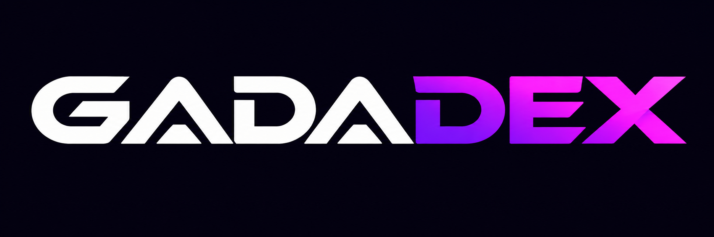

# GADADEX — Digital Asset Exchange Simulation



A modern, high-performance cryptocurrency exchange-style web application inspired by the functional organization and interface depth of platforms like Bybit, with a distinct **GADA** brand identity.

> **Scope Notice:** GADADEX operates strictly in **Simulation Mode (Paper Trading)**. All balances, market ticks, orders, order books, and transaction records are virtual and generated for educational and interface demonstration purposes. The platform does not execute real-money transactions, accept deposits, facilitate withdrawals, or hold real asset custody.

---

## 🌟 Key Features

### 1. Interactive Trading Workspace (`/trade` & `/trade/:pair`)
- **Interactive Candlestick Charts**: Powered by TradingView `lightweight-charts` with multi-timeframe options (`1m`, `5m`, `15m`, `1h`, `4h`, `1D`, `1W`), crosshairs, zoom, and volume histograms.
- **Simulated Order Book**: Dynamic bids & asks with cumulative market-depth fill bars, spread indicator, and price click-to-autofill.
- **Recent Trades Tape**: Real-time executed trade feed with green/red side indicators.
- **Order Entry Panel**:
  - Buy & Sell tabs with specialized color themes
  - Limit & Market order types
  - Percentage quick-select buttons (25%, 50%, 75%, 100%)
  - Simulated fee calculation (0.1%)
  - Balance validation & mandatory confirmation modal
- **Orders & Balances Table**: Open limit orders (with instant cancellation & fund unlock), Order History, Trade History, and Demo Balances.

### 2. Market Exploration (`/markets` & `/market/:symbol`)
- **All Markets Table**: Spot and GDT Ecosystem tabs with search, sorting by price, 24h change %, and volume.
- **Mini Sparklines**: SVG price trend graphs on table rows and featured cards.
- **Market Movers**: Top Gainers, Top Losers, and Most Active 24h turnover pairs.
- **Asset Detail Pages**: Deep dive into individual coins (BTC, ETH, SOL, GDT, BNB, XRP, DOGE) with stats, fundamentals, order book snapshot, and direct trade action.

### 3. Demo Portfolio Dashboard (`/portfolio`)
- Net Asset Valuation and 24h simulated PnL.
- **Asset Allocation Chart**: Interactive Recharts donut visualization.
- **Simulated Net Value Curve**: 7-day performance area chart.
- **Asset Holdings Breakdown**: Real-time balance tracker (Free vs. Locked in limit orders) and estimated USD valuations.
- **Demo Controls**: One-click portfolio reset and +5,000 USDT testnet faucet claim.

### 4. Ecosystem & Education
- **GADA Token Showcase (`/gdt`)**: Native utility token overview, simulated market stats, roadmap placeholders, and FAQ.
- **Learning Center (`/learn`)**: Categorized educational guides (Order Types, Risk Management, Chart Analysis, Simulation Guide) and a searchable Crypto Glossary.
- **Transaction History (`/history`)**: Filterable audit trail with CSV export and transaction detail modal.
- **Account & Settings (`/account`)**: VIP Demo trader profile, currency preferences, layout density toggles, and security demonstration.

---

## 🎨 Brand Identity & Design System

- **Primary Deep Purple**: `#24005E`
- **Midnight Background**: `#10091E`
- **Dark Surface**: `#171124`
- **Dark Surface Elevated**: `#1F1730`
- **Surface Border**: `#2A2238`
- **Violet Accent**: `#8000FF`
- **Electric Purple**: `#A020F0`
- **Magenta Highlight**: `#D946FF`
- **Bullish Green**: `#0ECB81`
- **Bearish Red**: `#F6465D`
- **Typography**: Inter paired with monospace tabular numerals for exact order book alignment.

---

## 🛠️ Tech Stack

- **Framework**: React 18 with TypeScript
- **Bundler & Dev Server**: Vite
- **Styling**: Tailwind CSS
- **State Management & Persistence**: Zustand (with `localStorage` persistence)
- **Financial Candlestick Charts**: `lightweight-charts` (TradingView)
- **Portfolio Visualizations**: `recharts`
- **Icons**: `lucide-react`
- **Hosting Target**: Cloudflare Workers / Cloudflare Pages

---

## 🚀 Getting Started

### Prerequisites
- Node.js (v18 or higher recommended)
- npm

### Installation
```bash
# Clone the repository
git clone <YOUR_REPO_URL>
cd GadaDex

# Install dependencies
npm install

# Start development server
npm run dev
```

The application will be available at `http://localhost:5173`.

### Production Build
```bash
# Compile TypeScript and bundle assets
npm run build

# Preview production build locally
npm run preview
```

---

## ☁️ Cloudflare Deployment

GADADEX is pre-configured for deployment to **Cloudflare Workers** or **Cloudflare Pages**.

### Deploy via Cloudflare Workers
```bash
npx wrangler deploy
```

`wrangler.toml` is configured with Static Assets and single-page-application fallback:
```toml
name = "gadadex"
compatibility_date = "2024-11-01"

[assets]
directory = "./dist"
not_found_handling = "single-page-application"
```

### Deploy via Cloudflare Pages
```bash
npx wrangler pages deploy dist
```
`public/_redirects` ensures all client-side routes (`/trade`, `/markets`, `/portfolio`, etc.) resolve to `/index.html` without 404 errors on direct browser refreshes.

---

## 📄 License
MIT License. Built for the GADA Ecosystem.
